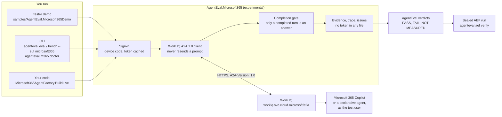
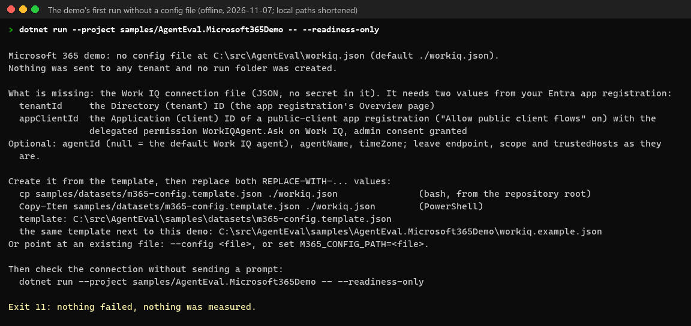
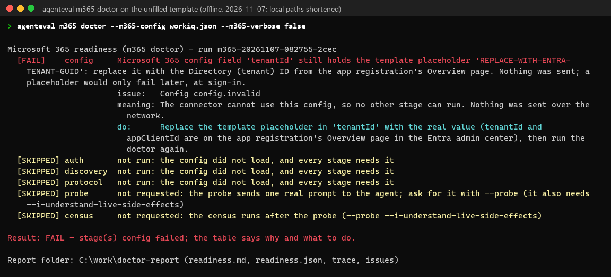
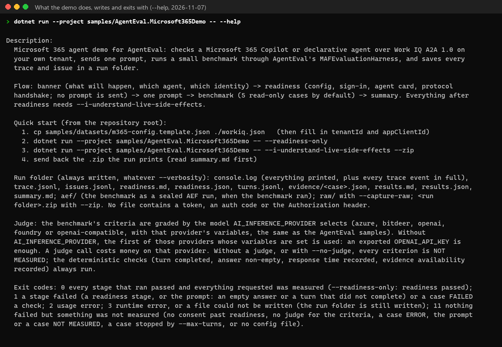

# Microsoft 365 at a glance

AgentEval evaluates Microsoft 365 agents: Microsoft 365 Copilot itself, or a declarative agent, reached over
Work IQ A2A 1.0. This page shows how the pieces fit, where to start, and where everything lives. A self-contained
[visual version](images/microsoft365/visual-guide.html) of this page opens in any browser.

> **Status: Experimental.** The integration is built and tested offline. Nobody has run it on a live tenant yet: the
> first live runs are its validation. Use a **non-production** tenant and test user.

## How it fits together

Every turn either completes with an answer, or ends with a typed outcome (failed, rejected, canceled, a pause for a
confirmation, or indeterminate). Only a completed turn is graded. A turn with several answer candidates and none
selected is NOT MEASURED, never a guess.

## Pick your path

| You are | Start here | First command |
|---|---|---|
| A tester with a tenant | [The demo](https://github.com/AgentEvalHQ/AgentEval/blob/main/samples/AgentEval.Microsoft365Demo/README.md) | `dotnet run --project samples/AgentEval.Microsoft365Demo -- --readiness-only` |
| A CLI user | [Microsoft 365](microsoft365.md) | `agenteval m365 doctor --m365-config workiq.json` |
| A developer | [Using it in code](microsoft365.md#using-it-directly-in-code-no-cli) | `Microsoft365AgentFactory.BuildLive(config, iUnderstandLiveSideEffects: true)` |

Every path needs the same tenant setup first.

## Set up a tenant

[Connect to a Microsoft 365 tenant](microsoft365-tenant-setup.md) gives each step, who does it, and what a failure
means. In short:

1. A Global Administrator enables Work IQ in the tenant, once.
2. A billing administrator puts the test user in a usage-based billing plan. Work IQ calls are billed as Copilot Credits.
3. Register an app as a public client (*Allow public client flows* = Yes).
4. Add the delegated permission `WorkIQAgent.Ask` and grant admin consent.
5. Check that device-code sign-in is allowed for the test user.
6. Write `workiq.json` and run the readiness check. It sends no prompt.

## What you get

- **A readiness report** (`readiness.md`, `readiness.json`): each stage, what it proves, and what to do when it fails.
- **A trace and an issue register** (`trace.jsonl`, `issues.jsonl`): every event and every problem, with the cause and
  who can fix it. No token, auth code or `Authorization` header is ever written.
- **Results** with honest verdicts: PASS, FAIL, NOT MEASURED or ERROR.
- **A sealed AEF run**, the house evidence record, that `agenteval aef verify` checks.
- **From the demo**: one run folder holding all of it, zipped with `--zip`, to send back.

## Where everything lives

| What | Where |
|---|---|
| The provider: sign-in, the A2A client, the conversation, evidence, diagnostics, readiness | [`src/AgentEval.Microsoft365`](https://github.com/AgentEvalHQ/AgentEval/blob/main/src/AgentEval.Microsoft365/README.md) |
| The CLI target (`--sut microsoft365`) and `agenteval m365 doctor` | `src/AgentEval.Cli/Microsoft365` |
| The tester demo, its offline tests, and its GitHub Copilot agent, skills and prompts | [`samples/AgentEval.Microsoft365Demo`](https://github.com/AgentEvalHQ/AgentEval/blob/main/samples/AgentEval.Microsoft365Demo/README.md), `samples/AgentEval.Microsoft365Demo.Tests`, `samples/AgentEval.Microsoft365Demo/.github` |
| Two samples: Hello World and a live walkthrough | `samples/AgentEval.Samples/Microsoft365` (menu group R) |
| A smoke dataset and the config template | `samples/datasets/m365-smoke.json`, `samples/datasets/m365-config.template.json` |
| A GitHub Copilot agent and skill for the whole repository | `.github/agents/agenteval-m365.agent.md`, `.github/skills/m365-eval/SKILL.md` |
| The offline tests | `tests/AgentEval.Tests/Microsoft365`, `tests/AgentEval.Tests/Cli/Microsoft365` |
| The docs | This page, [tenant setup](microsoft365-tenant-setup.md), [Microsoft 365](microsoft365.md), [tester guide](microsoft365-tester-guide.md), [results template](microsoft365-tester-RESULTS-TEMPLATE.md), and the `m365` sections of the [CLI reference](cli.md) |

## What it looks like

These are captured offline, with no tenant. Local paths are shortened.

The demo's first run, before `workiq.json` exists. It says what is missing, sends nothing, and exits `11`:

`agenteval m365 doctor` on the unfilled template. Each stage says what it means and what to do; the config stage stops
the run before anything is sent:

What the demo does, what it writes, and what its exit codes mean (`--help`):

